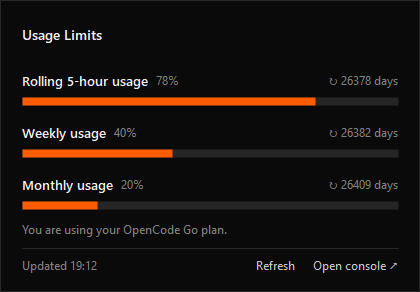
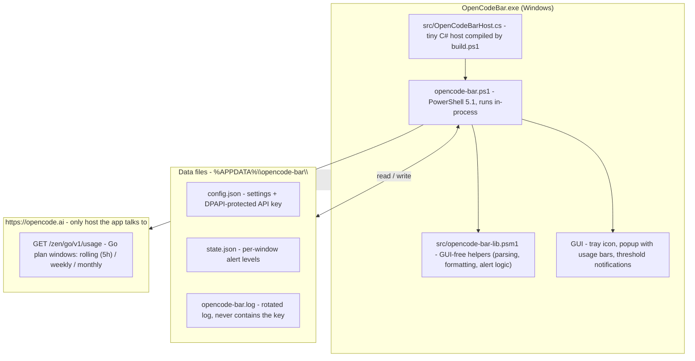

# OpenCode Bar for Windows

A small Windows tray app that shows your [OpenCode](https://opencode.ai) **Go** plan usage limits (rolling 5-hour, weekly and monthly windows) and notifies you when you get close to a limit.



> Unofficial. Not affiliated with or endorsed by OpenCode. It reads the same `GET /zen/go/v1/usage` endpoint the OpenCode console uses. That endpoint isn't documented and may change.

## Features

- **Tray icon with the OpenCode logo.** The icon is the OpenCode mark on a color-coded background that tracks your highest Go window usage: dark below 75%, orange from 75%, red from 90% (and `…` while loading, `!` on errors). Hover it for the exact percentages.
- **Popup on left click**, styled like a dark usage meter, with the OpenCode logo and one bar per Go window (rolling 5-hour, weekly, monthly) plus the time left until each window resets.
- **Notifications** when a window crosses 75%, 90% and 100% (once per threshold), and when a maxed-out window becomes available again.
- **Right-click menu**: refresh now, open the OpenCode console, set API key, start with Windows, quit.
- Nothing to install. It runs on Windows PowerShell 5.1 and .NET Framework, which ship with Windows 10/11.

## How it works

`OpenCodeBar.exe` is a tiny C# host that runs `opencode-bar.ps1` in-process (so Windows lists the app as "Open Code Bar" instead of "Windows PowerShell"). The script imports `src\opencode-bar-lib.psm1` — a GUI-free helper module (parsing, formatting, alert logic) that is unit-tested with Pester — polls the OpenCode usage endpoint on a timer, keeps your API key encrypted with DPAPI, and does all the tray/popup/notification work.



All settings and state live in `%APPDATA%\opencode-bar\` (see [Configuration](#configuration)). The API key is only ever sent as a Bearer token to `opencode.ai` — no telemetry, no other hosts. A fuller walkthrough lives in [docs/architecture.md](docs/architecture.md).

## Install

1. Download `OpenCodeBar-v0.1.0.zip` from [Releases](https://github.com/soaresfellipe/opencode-bar-windows/releases) and extract it anywhere (e.g. `C:\Tools\OpenCodeBar`). The zip has this layout — keep it intact:

   ```text
   OpenCodeBar.exe
   opencode-bar.ps1
   src\opencode-bar-lib.psm1
   README.md
   LICENSE
   ```

   `opencode-bar.ps1` imports `src\opencode-bar-lib.psm1` at startup, so the `src\` folder must stay next to the script.
2. Run `OpenCodeBar.exe`.
3. On first run it asks for an **OpenCode Go API key**. Create one in the [OpenCode console](https://opencode.ai/console).
4. Optional: right-click the icon and check **Start with Windows**.
5. Optional: in *Settings → Personalization → Taskbar → Other system tray icons*, turn **OpenCode Bar** on so the icon is always visible.

Windows SmartScreen may warn about the unsigned executable. You can also skip the exe and run the script directly (see below).

## Configuration

Settings live in `%APPDATA%\opencode-bar\config.json` (right-click → **Open settings folder**). Restart the app after editing.

| Key | Default | Description |
| --- | --- | --- |
| `pollMinutes` | `5` | How often to query the API. |
| `thresholds` | `[75, 90, 100]` | Usage percentages that trigger a notification. |
| `notifyPools` | `["go"]` | Which pools send notifications. |
| `trayPool` | `"go"` | Which pool the tray icon number reflects. |
| `apiBase` | `"https://opencode.ai"` | API base URL. |
| `apiKeyProtected` | *(empty)* | The API key, encrypted with DPAPI. Set through **Set API key** in the right-click menu rather than by hand. |

The `OPENCODE_GO_API_KEY` environment variable, if set, takes precedence over the stored key. It is the
only environment variable the app reads; see [`.env.example`](.env.example) for the full reference
(and note that the app does not load `.env` itself — set the variable in your shell).

## Privacy

- The API key is encrypted with Windows DPAPI, so only your Windows user can decrypt it. It is stored in `config.json`.
- The only network calls go to `opencode.ai`. There's no telemetry.
- Errors are logged to `%APPDATA%\opencode-bar\opencode-bar.log`. The log never includes the key.

## Run the script directly

```powershell
powershell -NoProfile -ExecutionPolicy Bypass -File opencode-bar.ps1
```

Developer flags:

| Flag | What it does |
| --- | --- |
| `-Mock samples\mock.json` | Use a local JSON file instead of the API. |
| `-Preview out.png` | Render the popup (and tray icon) to PNG and exit. |
| `-Dump` | Print the raw API response and exit. |

`OpenCodeBar.exe` passes the same flags through, e.g. `OpenCodeBar.exe -Mock samples\mock.json`.

## Build

`OpenCodeBar.exe` is a tiny host that runs `opencode-bar.ps1` in-process, so Windows lists the app as "OpenCode Bar" instead of "Windows PowerShell". To build it:

```powershell
powershell -NoProfile -ExecutionPolicy Bypass -File build.ps1
```

This generates `src\opencode-bar.ico` and compiles `OpenCodeBar.exe` with the C# compiler that ships with .NET Framework 4 (`csc.exe`). No SDK needed.

## Troubleshooting

Read `%APPDATA%\opencode-bar\opencode-bar.log` first — it records every fetch outcome and error, and never
contains the API key. Right-click the tray icon → **Open settings folder** to reach it plus `config.json`
and `state.json`.

| Symptom | Likely cause | What to do |
| --- | --- | --- |
| "No API key" prompt on every start | `apiKeyProtected` is empty, or was written by a different Windows user (DPAPI is per-user). | Right-click → **Set API key** and re-enter it. |
| Popup shows an error instead of usage | The fetch failed; the log line carries the HTTP status. | `401` = key missing/wrong. `403` = key without a Go subscription (EntitlementError). `429` = rate limited; wait or raise `pollMinutes`. |
| A threshold reached but no notification fired | That threshold already fired for that window. | Expected behavior — `state.json` records it and it re-arms when usage drops back below. |

## Contributing

All changes land on `main` through a pull request. See [AGENTS.md](AGENTS.md) for the full
agent/contributor workflow.

Install the local pre-commit gate once per clone (it runs the fast subset of CI before each
commit):

```powershell
pwsh -File tools\Install-Hooks.ps1
```

Quality gates, all defined in `tools/RepoChecks.ps1`:

```powershell
pwsh -File tools\RepoChecks.ps1 -Check all   # parse, lint, format, largefiles, secrets, tests, coverage
```

| Gate | What it enforces |
| --- | --- |
| `parse` | Zero PowerShell syntax errors, checked on Windows PowerShell 5.1 (the app's runtime). |
| `lint` | PSScriptAnalyzer with `PSScriptAnalyzerSettings.psd1`; every suppression carries a justification. |
| `format` | `Invoke-Formatter` is a no-op on every analyzed file. |
| `largefiles` | No tracked file over 1 MB; no code or doc over 1500 lines. |
| `secrets` | No key-shaped credential material in the worktree or in git history. |
| `tests` | The Pester suite (pinned to 5.7.1) passes. |
| `coverage` | Code coverage of `src/opencode-bar-lib.psm1` stays at or above 85%. |

## License

[MIT](LICENSE)
