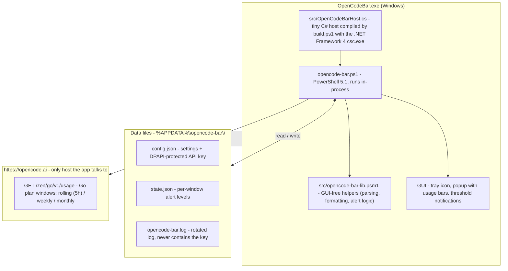

# Architecture

This is the architecture of OpenCode Bar today. The GUI-free helper module
(`src/opencode-bar-lib.psm1`) ships as part of the app and is covered by the Pester
suite; the popup renders one bar per Go plan window (rolling 5-hour, weekly,
monthly) from a single usage fetch per poll cycle.

## How the pieces fit

- **`OpenCodeBar.exe`** (`src/OpenCodeBarHost.cs`) is a minimal C# host so Windows shows the
  process as "OpenCode Bar" instead of "Windows PowerShell". It runs `opencode-bar.ps1`
  in-process; `$PSScriptRoot` still resolves to the exe folder.
- **`opencode-bar.ps1`** owns everything GUI and lifecycle: WinForms/GDI drawing, P/Invoke,
  the tray icon and popup, polling timer, threshold notifications, and the DPAPI key
  handling. It imports `src/opencode-bar-lib.psm1` from `$PSScriptRoot\src` at startup and
  reads/writes the shared data-layer state through the module's accessors. Dev flags
  (`-Mock`, `-Preview`, `-Dump`) short-circuit the GUI for validation.
- **`src/opencode-bar-lib.psm1`** holds the GUI-free, testable helpers (parsing, formatting,
  alert computation, tray look). It imports cleanly on pwsh/Linux so the Pester suite can
  run anywhere; the release zip ships it alongside the script. The `$Pools` registry holds
  the single `go` pool; `$Windows` holds the three API windows in display order.
- **The API contract** is the undocumented `GET /zen/go/v1/usage` endpoint: one `usage`
  object with `rolling` / `weekly` / `monthly` windows, each carrying `status`
  (`ok` | `rate-limited`), `percent` (0-100) and `resetsAt` (ISO timestamp). `rate-limited`
  is normalized to 100%; an expired `resetsAt` rolls the window back to 0.
- **State** lives in `%APPDATA%\opencode-bar\`: `config.json` (settings, DPAPI-protected key),
  `state.json` (which alert thresholds already fired per window), and `opencode-bar.log`.
- **The API key** is only ever sent as a Bearer token to `opencode.ai`. It is never
  logged and the app makes no other network calls (no telemetry).
